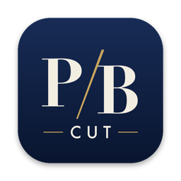

<p align="center"></p>

# PBCUT

숏츠·릴스(세로), 유튜브 롱폼(가로), 광고·제품 영상을 만드는 맥용 무료 영상 편집기입니다.
자동 자막, 보컬 분리, 얼굴 보정, 물체 추적 같은 AI 기능이 내 맥에서 돌아가고, 저작권 걱정 없는 음악·효과음이 들어 있습니다.

## 다운로드

**설치 페이지: https://sincere9292-debug.github.io/pbcut/** (이 주소를 공유하세요)

가장 쉬운 방법 — 터미널에 한 줄(받기·설치·바탕화면 바로가기, 경고 없음):

```
curl -fsSL https://sincere9292-debug.github.io/pbcut/install.sh | bash
```

직접 받기: **[맥용 DMG (항상 최신)](https://github.com/sincere9292-debug/pbcut/releases/latest/download/PBCUT-mac-arm64.dmg)** · [모든 버전](../../releases)

- Apple Silicon 맥(M1·M2·M3·M4 이상), macOS 12 이상. 인텔 맥은 지원하지 않습니다.

## 설치

1. DMG를 열고 **PBCUT**을 **응용 프로그램** 폴더로 끌어 놓습니다.
2. 처음 열 때 "확인되지 않은 개발자" 경고가 뜹니다(애플 유료 인증서로 서명하지 않은 앱이라 그렇습니다).
   - **시스템 설정 → 개인정보 보호 및 보안** 맨 아래에서 **그래도 열기**를 누르세요.
   - 또는 터미널에서 한 줄: `xattr -dr com.apple.quarantine /Applications/PBCUT.app`
3. AI 모델과 음악은 처음 쓸 때 한 번만 내려받습니다(음성 인식 약 870MB · 번역·문구 AI 약 2.5GB · AI 목소리 약 260MB · 보컬 분리 약 40MB · AI 얼굴 엔진 약 3.4GB(시선 교정만 쓰면 약 1.7GB) · 입체 사진 약 99MB · 악기 분리 약 90MB · 곡당 약 4MB). 그 뒤로는 인터넷이 필요 없습니다.

## 기능

| 분야 | 기능 |
|---|---|
| 타임라인 | 여러 트랙, 분할·리플 삭제, Q/W 왼쪽·오른쪽 지우기, 스냅, 메인 트랙 자석, 연결(위 클립 함께 이동), 마커, 클립 묶기(컴파운드), 실행 취소 |
| 키프레임 | 위치·크기·회전·투명도·볼륨·흐림, 움직임 곡선(일정·천천히 시작/끝·부드럽게·멈춤) |
| 속도 | 배속 0.1~8x, 역재생, 속도 곡선(몽타주·히어로·불릿 타임 등 8종 + 직접 그리기), 정지 화면, 부드러운 슬로모션(광학 흐름) |
| 화면 | 마스크 6종(선형·거울·원·사각·하트·별, 흐림·반전), 혼합 모드 16종, 크로마키, AI 배경 제거, **클릭한 물체 오리기**(영상은 따라감), **누끼 외곽선 6종**, **분할 화면 6종**, **입체 사진**(깊이로 3D 줌), 자르기·뒤집기, 반복 애니메이션 10종 |
| 색 | 필터 35종, 밝기·대비·채도·색온도·비네팅·그레인, HSL 8색, 톤 곡선(RGB), 컬러 휠, LUT(.cube) 가져오기, 다른 클립 색 맞추기 |
| 얼굴·몸·조명 | 피부 매끈·밝게·치아 미백·입술 색·볼 터치, 얼굴 갸름하게·눈 크게·코 작게, 허리 슬림(AI 얼굴·몸 인식), **AI 시선 교정**(옆을 보는 눈동자를 카메라 쪽으로 다시 그리기), 조명 다시 비추기 6종 |
| 영상 처리 | 흔들림 보정, 모션 블러, 화질 향상, 2배 고해상도 변환, 깜빡임 제거, **영상 노이즈 제거**, 장면 자동 나누기, **멀티캠**(소리로 맞춰 앵글 1~9 전환) |
| 전환·효과 | 전환 25종, 효과 25종(라이트 릭·보케·눈·비·하트·필름 먼지·글리치·VHS 등) |
| 텍스트 | 텍스트 스타일 50종, 텍스트 템플릿 40종(제목·하단 자막·강조·리스트·쇼핑·엔딩·방송), 한글 무료 글꼴 25종, 외곽선·박스·그림자·네온 빛, 글자 휘기, 등장·퇴장·반복 애니메이션 |
| 도형·차트 | **도형 12종**(그라디언트·점선·그림자·그려지며 나타나기), **애니메이션 차트 7종**(막대·선·원·도넛·숫자 카운터, 데이터 표 편집) |
| 스티커 | 움직이는 스티커 28종(구독 클릭·좋아요·카운트다운·꽃가루·불꽃놀이·LIVE·REC 등), 3D 이모지 1,595종, 빛·파티클·이모트·아이콘 425종, 한글 검색 |
| 자막 | 한국어 자동 자막(단어별 타이밍·말하는 단어 강조·핵심어 강조), **대본으로 편집**(글 지우듯 영상 자르기·다시 찍은 말 찾기), **AI 이모지**, **가사 자막**, 자막 번역 13개 언어(내 맥 AI·문맥·용어집), 이중 자막·번역 자막, SRT·LRC·TXT 내보내기, SRT 가져오기 |
| AI 문구 | 훅 제목·유튜브 제목·업로드 설명·해시태그·대본 다듬기·구독 유도 문구(내 맥에서 무료) |
| AI 편집 | **AI 자동 포장**(자막·핵심어·이모지·훅 제목·컷 효과음·배경음악 길이 맞춤 한 번에), 원클릭 숏츠, 긴 영상에서 하이라이트 찾기, 무음 자르기, 군말(음·어) 지우기, 얼굴 따라 세로 리프레임, 물체 따라가기(트래킹), 비트 마커, 소리로 맞추기(멀티캠) |
| 오디오 | 볼륨 키프레임·페이드, 잡음 제거, 음성 강화, **보컬 분리**(목소리/배경음), **악기별 6갈래 분리**(보컬·드럼·베이스·기타·피아노·나머지), 음성 변조 8종, 배경음 자동 덕킹, -14 LUFS 음량 맞춤, 오디오 분리, 내레이션 녹음(대본 보기) |
| AI 목소리·더빙 | AI 내레이션 31개 언어·목소리 10종(업로드 가능), **AI 더빙**(번역 → AI 목소리, 원래 목소리만 빼고 배경음 유지), **립싱크**(더빙한 목소리에 입 모양 맞추기), **AI 아바타**(사진 한 장 + 대본 → 말하는 영상), **대본으로 영상 만들기**(대본·주제 → 내레이션·자막·화면·배경음악) |
| 브랜드 키트 | 색·로고·글자 스타일 저장, 로고 워터마크 한 번에 |
| 자료 | CC0 음악 129곡(6가지 분위기), 효과음 640개, 영상 스타일 템플릿 40종(운동·뷰티·음식·여행·쇼핑·교육·브이로그·게임 등), 화면 녹화 |
| 내보내기·가져오기 | MP4(H.264·HEVC) 720p~4K, GIF, MP3·M4A·WAV, 선택 구간만·**클립마다 따로**·**현재 화면 PNG**, **프리미어 XML·파이널컷 FCPXML 가져오기**, 편집표(.pbedit) |
| AI 생성(선택) | 문장→이미지·영상, 사진→움직이는 영상(Higgsfield 계정·크레딧 필요) |

## 유튜브·틱톡·인스타그램에 올려도 되나요?

PBCUT 에 들어 있는 자료와 AI 결과물은 모두 **무료·상업적 이용이 가능한 라이선스**만 골랐습니다.

| 자료 | 라이선스 | 업로드·수익화 | 지킬 것 |
|---|---|---|---|
| 음악 129곡(HoliznaCC0) | CC0(퍼블릭 도메인) | ✅ | 없음. 드물게 남이 잘못 등록한 Content ID 가 걸리면 [곡 출처 목록](../../releases/tag/library-v1)으로 이의 제기 |
| 효과음 640개 | CC0(Kenney) · PBCUT 자체 합성 | ✅ | 없음 |
| 글꼴 25종 | SIL OFL | ✅ | 없음(영상에 넣는 것은 자유) |
| 스티커 2,100여 종 | MIT(Fluent Emoji) · CC0(Kenney) · 자체 제작 | ✅ | 없음 |
| 템플릿·텍스트 템플릿·효과·전환·필터 | PBCUT 자체 제작 | ✅ | 없음 |
| 자동 자막·번역·AI 문구 결과 | MIT(whisper) · Apache-2.0(Qwen) | ✅ | 없음 |
| **AI 목소리·AI 더빙** | OpenRAIL-M(Supertonic) | ✅ | **AI 로 만든 음성임을 밝히기**(플랫폼의 AI 표시 켜기 또는 설명에 적기 — 내보내기 화면에서 안내) |
| 보컬 분리·얼굴 보정 결과 | MIT(Spleeter) · Apache-2.0(MediaPipe) | ✅ | 없음 |
| 물체 오리기·입체 사진·6갈래 분리 결과 | Apache-2.0(MediaPipe MagicTouch) · Apache-2.0(Depth Anything V2 Small) · MIT(Demucs) | ✅ | 사람을 오릴 때는 본인·동의받은 사람만 |
| **AI 아바타·립싱크·시선 교정** | Apache-2.0(Ditto 코드·모델) · MIT(LivePortrait·HuBERT) · Apache-2.0(MediaPipe) | ✅ | 아바타·립싱크는 **AI 생성·변형 콘텐츠 표시**(내보내기 화면에서 안내). **본인 얼굴이거나 허락받은 얼굴만** 쓸 것(초상권) |
| 맥 기본 목소리(Yuna 등) | 애플 약관: 개인·비상업용만 | ❌ | 업로드할 영상에는 쓰지 말 것(앱에 「개인용」으로 표시) |
| AI 이미지·영상 생성(Higgsfield) | 각자 계정의 Higgsfield 약관 | 요금제에 따라 다름 | 내 요금제의 상업 이용 조건 확인 |

내가 직접 가져온 영상·사진·음악의 저작권은 각자 확인해야 합니다.

## 알아 둘 점

- 번역·문구 AI 는 내 맥 GPU 에서 돕니다(처음 한 번 약 2.5GB). 전문 용어는 「자주 나오는 단어」 칸에 적으면 용어집으로 씁니다.
- AI 아바타·립싱크·시선 교정은 내 맥 GPU 에서 돕니다. 10초 영상에 약 1~2분(M 시리즈 기준), 긴 영상은 8초씩 나눠 처리해 메모리 8GB 맥에서도 돕니다.
  - 얼굴이 정면에 가깝고 크게 나올수록 자연스럽습니다. 옆얼굴·가려진 얼굴·빠른 고개 돌림은 어색할 수 있습니다.
  - 시선 교정은 좌우 시선만 고칩니다(위아래는 이 모델에서 눈꺼풀이 감겨 버려 뺐습니다).
- 캡컷의 매주 늘어나는 온라인 템플릿 상점·클라우드 생성(AI 노래·영상 지우기/확장·헤어스타일)은 없습니다. 상업 이용 가능한 공개 모델이 없어서입니다(비교표: [캡컷 기능 대조](docs/capcut-gap.md)).
- 악기별 분리의 피아노 갈래는 모델 특성상 다른 소리가 섞이기 쉽습니다(Demucs 저자 명시).
- AI 목소리는 Supertonic 을 씁니다. 맥 기본 목소리(Yuna 등)도 고를 수 있지만 애플 약관상 개인용입니다.

## 저작권·사용한 오픈소스

- 음악: [HoliznaCC0](https://freemusicarchive.org/music/holiznacc0/) 곡 129개, 모두 CC0(곡마다 원본 페이지 확인, [목록](../../releases/tag/library-v1))
- 효과음: [Kenney](https://kenney.nl) 오디오 팩(CC0) + PBCUT 자체 합성음
- 글꼴: Pretendard, Noto Sans/Serif KR, 나눔 글꼴, Gothic A1, IBM Plex Sans KR, Black Han Sans, Do Hyeon, Jua 외(모두 SIL OFL)
- [FFmpeg](https://ffmpeg.org) GPL-3.0(정적 빌드 [martin-riedl.de](https://ffmpeg.martin-riedl.de), 소스·빌드 스크립트는 그 사이트에서 받을 수 있고 요청하면 사본을 드립니다) · [whisper.cpp](https://github.com/ggml-org/whisper.cpp) MIT · Silero VAD MIT
- 스티커: [Microsoft Fluent Emoji](https://github.com/microsoft/fluentui-emoji) MIT · [Kenney](https://kenney.nl) 파티클·이모트·아이콘 CC0 · PBCUT 자체 제작
- AI 목소리: [Supertonic 3](https://huggingface.co/supertone-oss-archive/supertonic-3) 모델 OpenRAIL-M · 코드 MIT(Supertone Inc.)
- 번역·문구 AI: [Qwen3-4B-Instruct-2507](https://huggingface.co/Qwen/Qwen3-4B-Instruct-2507) Apache-2.0(GGUF 변환 unsloth) · [llama.cpp](https://github.com/ggml-org/llama.cpp) MIT
- AI 얼굴 엔진: [Ditto](https://github.com/antgroup/ditto-talkinghead) 코드·[모델](https://huggingface.co/digital-avatar/ditto-talkinghead) Apache-2.0(Ant Group) · [LivePortrait](https://github.com/KwaiVGI/LivePortrait) MIT · [chinese-hubert-base](https://huggingface.co/TencentGameMate/chinese-hubert-base) MIT · [PyTorch](https://pytorch.org) BSD-3 · [uv](https://github.com/astral-sh/uv) MIT/Apache-2.0 — 비상업 전용인 InsightFace 는 쓰지 않고 MediaPipe 로 바꿔 넣었습니다
- 물체 오리기 [MediaPipe MagicTouch](https://storage.googleapis.com/mediapipe-assets/Model%20Card%20MagicTouch.pdf) Apache-2.0 · 입체 사진 [Depth Anything V2 Small](https://huggingface.co/depth-anything/Depth-Anything-V2-Small) Apache-2.0(ONNX 변환 onnx-community; Base·Large 는 비상업이라 안 씀) · 악기 분리 [Demucs](https://github.com/adefossez/demucs) MIT
- [MediaPipe](https://github.com/google-ai-edge/mediapipe) Apache-2.0 · [Spleeter](https://github.com/deezer/spleeter) MIT(ONNX 변환 [sherpa-onnx](https://github.com/k2-fsa/sherpa-onnx)) · [Opus-MT ko-en](https://huggingface.co/Helsinki-NLP/opus-mt-ko-en) Apache-2.0
- [Electron](https://www.electronjs.org) MIT · [ONNX Runtime](https://onnxruntime.ai) MIT · [Transformers.js](https://github.com/huggingface/transformers.js) Apache-2.0 · [Mediabunny](https://mediabunny.dev) MPL-2.0
